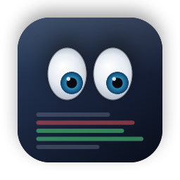

# Eyeballs

A Mac app for reviewing your coding agent's work, one layer of the stack at a time, before it goes out wider.

When an agent builds a stack of pull requests, you want to read it and leave it comments, like a GitHub review. But the code is still on your machine, and the agent can't see comments in your editor. Eyeballs gives you a review window that the agent opens itself. You comment on lines, the agent replies and fixes the code, and you resolve the threads. Nothing goes to GitHub until you push.



## Status

Eyeballs is at an early stage, but the whole review loop works, and a Claude Code plugin teaches the agent the loop and wakes it when you send a review. The plan is in [the design document](docs/design.md).

## Use it with Claude Code

1. **Install the command.** Open Eyeballs, then choose **Eyeballs → Install Command Line Tool…**. It links `~/.local/bin/eyeballs` to the command inside the app.
2. **Install the plugin.** In Claude Code 2.1.275 or later, run `/plugin install eyeballs --marketplace danielcooper/eyeballs`. On older versions, run `claude plugin marketplace add danielcooper/eyeballs`, then `claude plugin install eyeballs@eyeballs`. From a local clone, pass the clone's folder to `marketplace add` instead.
3. **Let agents run the command.** Add `"Bash(eyeballs *)"` to `permissions.allow` in `~/.claude/settings.json`, so the agent can run `eyeballs` without asking you each time. `eyeballs doctor` prints the line.
4. **Ask for a review.** With its stack committed, tell the agent to open it in Eyeballs, or run `/eyeballs:review`.

Then the loop runs by itself:

1. **The agent opens a review.** It runs `eyeballs review`, then waits in the background.
2. **You review.** Comment in the window, then choose **Finish review**.
3. **The agent wakes up.** Its background wait, the plugin's monitor or its Stop hook tells it a review is waiting. It reads your comments with `eyeballs inbox`.
4. **The agent replies.** It fixes the code, answers every thread with `eyeballs reply --file -`, and runs `eyeballs review` again. The window moves to the new revision.

The plugin adds a `review` skill, hooks that start a session with its Eyeballs status and stop the agent from finishing while your comments wait, and a monitor that starts once the skill runs. Its hooks do nothing until Eyeballs is installed and the session has a review open.

`Scripts/fake-agent.sh` runs the same loop against a Debug build, with the script playing the agent and checking every answer.

## How it works

1. **The agent opens a review.** When its stack is committed, the agent runs `eyeballs review`. Eyeballs reads the stack from [gh-stack](https://github.com/github/gh-stack) and shows each layer's own diff.
2. **You comment.** Comment on a line, a range, a file or a whole layer, then submit the review.
3. **The agent replies.** It reads your comments with `eyeballs inbox`, fixes the code, and answers each thread as addressed, declined or a question.
4. **The threads follow the code.** When the agent rebases or amends the stack, each thread moves with its lines. If the lines are gone, the thread says it is outdated and keeps the original code.
5. **Only you finish things.** Only you resolve threads, approve a stack or push.

Requires macOS 15 or later.

## Your data

Eyeballs keeps its database in `~/Library/Application Support/Eyeballs/`, readable only by you. Debug builds use `Eyeballs-Debug/` beside it, so they never touch your real reviews.

Comments you have started but not added or sent are saved in `drafts.json` in the same folder, so they survive a restart.

It backs the database up once a day, and before every upgrade that changes the database, into the `Backups` folder there. It keeps the 14 newest daily backups. To restore one:

1. Quit Eyeballs.
2. Delete `eyeballs.sqlite`, `eyeballs.sqlite-wal` and `eyeballs.sqlite-shm`.
3. Copy the backup you want to `eyeballs.sqlite`.
4. Open Eyeballs.

## Building from source

The project uses [XcodeGen](https://github.com/yonaskolb/XcodeGen) to generate the Xcode project from `project.yml`.

```bash
# Install XcodeGen if you don't have it
brew install xcodegen

# Generate the Xcode project
xcodegen generate

# Open in Xcode
open Eyeballs.xcodeproj
```

Then build and run from Xcode. To sign with your own team, change `DEVELOPMENT_TEAM` in `project.yml`.

Debug builds use their own bundle ID, `coops.eyeballs.debug`, and their own URL scheme, `eyeballs-debug://`, so they never pick up links meant for the release app.

The `eyeballs` command is built into the app, at `Eyeballs.app/Contents/Helpers/eyeballs`.

Most of the logic lives in a Swift package with no dependencies, so you can test it without Xcode's project:

```bash
swift test --package-path Packages/EyeballsCore
```

The app icon is drawn in code. To change it, edit `Tools/MakeIcon.swift`, then regenerate the PNGs:

```bash
swiftc -O Tools/MakeIcon.swift -o /tmp/makeicon && /tmp/makeicon Eyeballs/Media.xcassets/AppIcon.appiconset
```

### Releases

Every push to `main` is built by GitHub Actions, and the app is attached to the workflow run. Pushing a version tag builds it and publishes a GitHub release:

```bash
git tag v0.1.0
git push origin v0.1.0
```

Builds aren't signed with an Apple Developer ID or notarised, so macOS blocks the first launch. Open **System Settings → Privacy & Security** and click **Open Anyway**, or run:

```bash
xattr -dr com.apple.quarantine /Applications/Eyeballs.app
```

## Licence

Copyright © 2026 Daniel Cooper.

Eyeballs is free software: you can redistribute it and/or modify it under the terms of the GNU General Public License as published by the Free Software Foundation, either version 3 of the License, or (at your option) any later version. See [LICENSE](LICENSE).

Eyeballs uses [Swift Argument Parser](https://github.com/apple/swift-argument-parser) by Apple, under the Apache License 2.0, and [GRDB](https://github.com/groue/GRDB.swift) by Gwendal Roué, under the MIT License.
